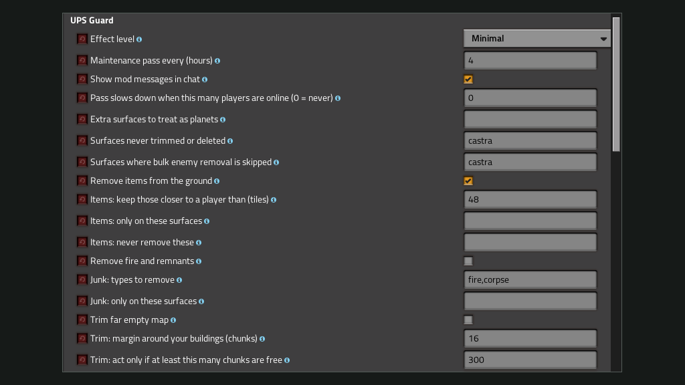
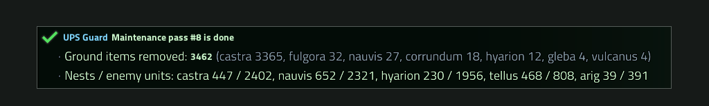
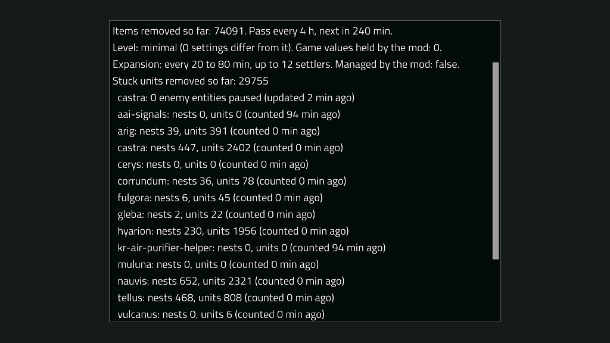

**Support in English and Russian / Поддержка на русском и английском.** Questions, bugs and ideas: Discussion tab.

# UPS Guard

**Keep a heavy multiplayer save fast.** Pick an effect level and every few hours the mod quietly clears what the game works on for nothing: items on the ground, far empty map, planets nobody uses and enemy bases nobody is near. It works in small steps, so there is no freeze, and there is nothing to set up.

Choose a level (minimal, medium, high or extreme) and you are done. Every part is also a separate setting, and one `/upg` command shows what is going on. Nothing in the mod is tied to a server or a planet name.

*Mod settings: the effect level on top, every part below it as its own setting.*

- **Four levels**: minimal is safe for any save, extreme means UPS over comfort.
- **Everything is optional**: change any single value after you pick a level.
- **One clear card**: each pass ends with one chat message, only the lines that have something to say.

---

# Pick how far to go

What does not touch play is on early. What makes the game easier starts a little on High and opens up on Extreme. What makes it harder for players (asteroid spawning, robot building) is Extreme only. Each level includes the one below.

- **Minimal** (default): ground items, trimming of far empty map (24 chunks margin), deleting planets nobody ever used (12 h after a platform leaves), the enemy count. Almost nothing changes in the game.
- **Medium**: also pauses far enemy bases on every planet (wide live zone), removes fire and remnants, clears pollution on planets with no nests, slows enemy expansion and tunes new planets a little, lowers enemy pathfinding a little.
- **High**: all of that, stronger, plus automatic thinning when a planet has too many nests, deleting planets that were used and left empty for 24 h, slower pollution spreading, an asteroid limit around platforms.
- **Extreme**: strongest values, planets left empty are deleted after 12 h, pollution is cleared even where enemies live, asteroids spawn at 75%, robots build at 75% speed. The game stays playable.

## Change it while you play

Everything works in a running game, no restart is needed. Pick a level in the mod settings (Map tab) and its settings are written at once, with a message in chat. After that you can change any single setting and it takes effect right away. The level name stays as it was, and `/upg status` tells how many settings differ from it.

To go back to a level, for example if your changes turned out too strong, type `/upg preset medium confirm` (use the level you want). Without `confirm` the command only shows what would change. Values the mod changes in the game (pathfinding, pollution, asteroids, robots, expansion) are saved first and put back when you switch the setting off.

## What you see in chat

Players get a short notice 30 minutes and 1 minute before a pass that has work to do, a warning before a planet that was used is deleted, and one card when the pass is done. Admins can switch messages off for everyone with the setting "Show mod messages in chat", and every player can hide them with `/upg messages off`.

# How much will you notice

These are rough estimates for a big multiplayer save with many enemy bases and idle planets, not measurements. A small save gains little, and the more enemy bases, idle planets and old map you have, the more each level removes.

| Level | Expected UPS gain |
| --- | --- |
| Minimal | 0-2% |
| Medium | 5-15% |
| High | 10-25% |
| Extreme | more than High, at the cost of comfort |

Check it on your own save: `/upg status` shows what was removed, `/upg profile on` adds the time per job, and the game's time usage panel (F4 debug menu) shows the real change.

# See what it did

The end of each pass is one card in chat. `/upg status` has the totals, and `/upg profile on` adds the time per job.

*The card after a pass: what was removed on which planet and how many nests and enemies are left.*

*`/upg status`: totals, the level, and nests and units per planet.*

Players can hide the messages with `/upg messages off`.

# What it does

- **Ground items and junk**: removes items, fire and remnants away from players.
- **Map trimming**: deletes generated chunks far from everything you built, from radars, artillery and players.
- **Planets**: deletes planets nobody ever used, planets left empty for a set time, or planets you name once. A deleted planet is generated again if someone travels there, and its enemy evolution starts over. Players get a chat warning before a planet that was used is deleted.
- **Enemy bases**: pauses far enemy bases so they cost nothing per tick, wakes them near players, and can thin them.
- **Counts and trains**: warns when a planet has too many nests or units, or many trains cannot find a path.
- **Space platforms**: keeps asteroids around platforms under a limit. Platforms themselves are never touched.
- **Pollution**: clears it on planets with no nests, and can make it spread less.
- **Game numbers**: lowers enemy pathfinding, attack groups, asteroid spawning and robot building work.
- **Expansion and new planets**: sets expansion pauses and tunes nests and the safe area on planets generated for the first time.
- **Admin tools**: bulk enemy removal in artillery reach or near your base, an entity report, presets.

## Commands

One command, `/upg`, and `/upg help` lists the subcommands. Players can see the status, surfaces, stuck trains and settings. Admins can change any setting with `/upg set`, run the pass by hand and use the cleanup tools. Anything that removes things only counts until you add `confirm`.

## Compatibility

Factorio 2.1 and 2.0 (separate downloads). Works without Space Age; with it, planets and platforms are handled too. English and Russian.

Works with other mods. No mod, planet or server name is built in, so planets and enemy factions from other mods are treated like the vanilla ones: the mod sees every planet, and you can list extra surfaces to count as planets, or surfaces that must never be trimmed or deleted. Enemy bases of any faction can be paused and thinned. It changes no prototypes and adds no items, so it does not conflict with other mods' content. Values it changes in the game (pathfinding, pollution, asteroids, robots, expansion) are saved first and put back when you switch the setting off.

If Factory Radar is installed, its shift summary ends together with the maintenance pass.

## Support

Questions, bugs and ideas: Discussion tab.
